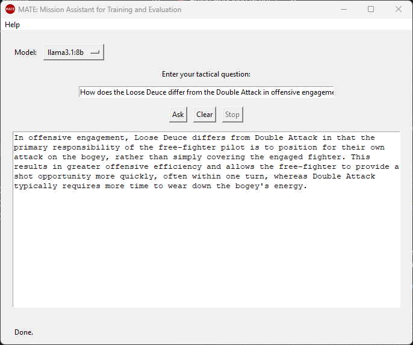

# MATE: Mission Assistant for Training and Evaluation

MATE is an offline language-based support tool for tactical decision-making and pilot training in air combat operations. It answers natural language questions about doctrinal and tactical manuals using retrieval-augmented generation (RAG): relevant passages are retrieved from a local FAISS index and passed as context to an open-weight language model served locally by [Ollama](https://ollama.com). No internet connection is required at runtime.

This repository accompanies the paper *Offline Language-Based Support System for Tactical Decision-Making in Air Combat Operations* (LatinX in AI Workshop @ NeurIPS 2025).



## How it works

```
Documents (.txt/.pdf/.docx) -> text chunks -> embeddings -> FAISS index
                                                               |
User question -> embedding -> top-k similar chunks -------------+
                                        |
                       context + question -> local LLM (Ollama) -> answer (streamed to the GUI)
```

| Component | File | Description |
|:---|:---|:---|
| Configuration | `src/config.py` | All settings, overridable by environment variables |
| Retrieval | `src/retrieval.py` | Document conversion, chunking, embeddings (SentenceTransformers), FAISS search |
| Indexing | `src/index_documents.py` | Rebuilds the FAISS index from the `docs/` folder |
| LLM interface | `src/llm_interface.py` | Prompt construction and (streaming) calls to the Ollama API |
| Backend | `src/app.py` | FastAPI server exposing the RAG pipeline |
| GUI | `src/gui.py` | Tkinter desktop interface with model selection, streaming, and Ask/Clear/Stop |

## Requirements

- Windows, Linux, or macOS with Python 3.10+
- [Ollama](https://ollama.com/download) with at least one model. The paper evaluated the three below; Mistral NeMo obtained the best ratings and is the default:

  ```bash
  ollama pull mistral-nemo
  ollama pull llama3.1:8b
  ollama pull qwen2.5:14b
  ```

- Optional: an NVIDIA GPU. Embeddings run on CUDA automatically when a CUDA-enabled PyTorch is installed (see [pytorch.org](https://pytorch.org/get-started/locally/)); otherwise they run on CPU.

Internet access is only needed for the initial setup (Python packages, the embedding model, and the Ollama models). After that, MATE runs fully offline.

## Quick start (Windows)

1. Put your reference documents in `docs/` (see [docs/README.md](docs/README.md)).
2. Run the scripts in `scripts/`:

   ```bat
   scripts\setup.bat   :: one time: creates venv\ and installs dependencies
   scripts\build.bat   :: builds the FAISS index and packages the GUI as dist\mate.exe
   scripts\start.bat   :: starts the backend and opens the GUI
   ```

   Run `build.bat` again whenever documents or code change. Make sure Ollama is running (`ollama serve` or the Ollama desktop app).

## Manual usage (any OS)

```bash
python -m venv venv
# Windows: venv\Scripts\activate    Linux/macOS: source venv/bin/activate
pip install -r requirements.txt

cd src
python index_documents.py                                   # build the index from ../docs
uvicorn app:app --host 127.0.0.1 --port 8000                # start the backend
python gui.py                                               # in another terminal: open the GUI
```

The backend can also be queried directly:

```bash
curl -X POST http://127.0.0.1:8000/ask \
     -H "Content-Type: application/json" \
     -d '{"question": "What is the primary advantage of flying as a section?", "model": "llama3.1:8b"}'
```

| Endpoint | Method | Description |
|:---|:---|:---|
| `/ask` | POST | Returns the answer, the retrieved chunks, and their similarity scores |
| `/ask_stream` | POST | Streams the answer as plain text |
| `/models` | GET | Lists the models installed in Ollama |
| `/reindex` | POST | Rebuilds the FAISS index |
| `/health` | GET | Health check |

## Configuration

Settings are defined in `src/config.py` and can be overridden with environment variables:

| Variable | Default | Description |
|:---|:---|:---|
| `OLLAMA_MODEL` | `mistral-nemo` | Default model, preselected in the GUI when installed (any installed model can be chosen) |
| `OLLAMA_URL` | `http://localhost:11434/api/generate` | Ollama generation endpoint |
| `EMBEDDING_MODEL` | `paraphrase-multilingual-MiniLM-L12-v2` | SentenceTransformers embedding model |
| `CHUNK_SIZE` / `CHUNK_OVERLAP` | `1200` / `250` | Chunk size and overlap, in characters |
| `TOP_K` | `5` | Number of retrieved chunks |
| `MAX_CONTEXT_CHARS` | `4000` | Maximum context length passed to the LLM, in characters |
| `SYSTEM_PROMPT` | see `config.py` | System prompt (the default restricts answers to the evaluated chapter) |
| `DOCS_FOLDER` / `EMB_FOLDER` | `docs/` / `embeddings/` | Document and index folders |
| `MATE_API_URL` | `http://127.0.0.1:8000` | Backend URL used by the GUI |

The default system prompt reproduces the evaluation setting of the paper. Change `SYSTEM_PROMPT` when using other documents.

## Documents

The manual used in the paper is copyrighted and is not included. Neither the `docs/` contents nor the generated `embeddings/` index are tracked by Git, since both contain the full text of the indexed documents. Do not commit classified or restricted material.

## Citation

```bibtex
@inproceedings{dantas2025offline,
  title     = {Offline Language-Based Support System for Tactical Decision-Making in Air Combat Operations},
  author    = {Dantas, Joao P. A.},
  booktitle = {LatinX in AI Workshop at the Conference on Neural Information Processing Systems (NeurIPS)},
  year      = {2025}
}
```

## License

Released under the MIT License. See [LICENSE](LICENSE).
